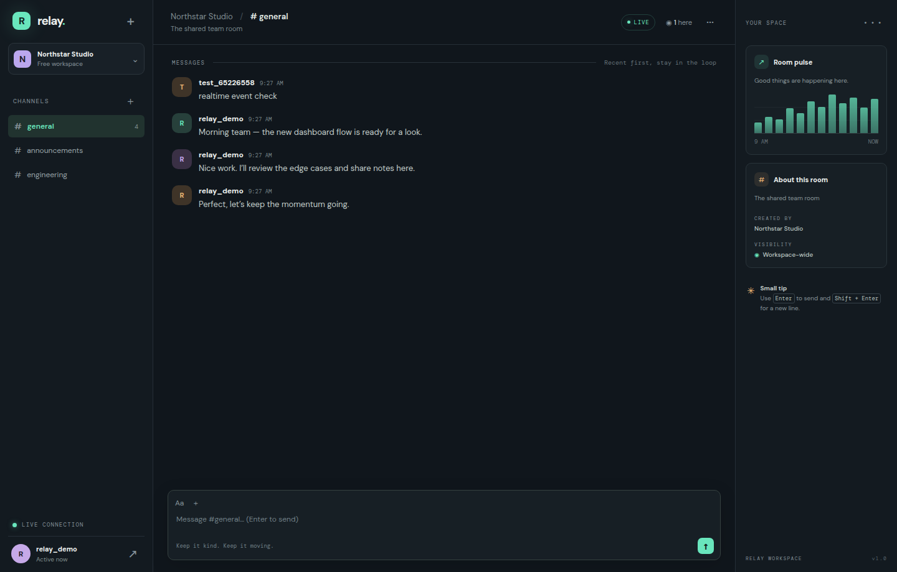

# Relay: Real-Time Team Chat Application

**Course assignment — REST APIs, WebSockets and persistent data**  
**Project:** Relay  
**Date:** 7 October 2026

> Relay demonstrates client–server communication through a JSON REST API and authenticated Socket.IO events. SQLite provides durable storage; REST remains the source of truth and websocket events distribute committed changes to active clients.



*Figure 1. Relay team chat interface. The screenshot is captured from the running project.*

## 1. Problem statement and objectives

Teams need a shared place to exchange short updates without waiting for page refreshes. This project implements a room-based chat where users register and authenticate, retrieve room history, create and edit their own messages, and receive new messages and edits in real time. The application also demonstrates status codes, validation, database connectivity, authorization and error handling.

### Demonstrated capabilities

The browser exchanges JSON with Express over HTTP and connects to Socket.IO using an authenticated handshake. Passwords are stored as bcrypt hashes rather than plaintext. SQLite persists accounts, rooms and messages. The frontend handles registration/login, room selection, chat history, create/edit/delete, typing indicators and live room creation. The design adapts to narrow mobile screens.

## 2. System design and architecture

```text
┌─────────────────────────────┐         HTTPS/HTTP JSON          ┌────────────────────────────┐
│ Browser: HTML/CSS/JavaScript│ ───────────────────────────────▶ │ Express REST API            │
│                             │ ◀──── JSON + status codes ────── │ JWT auth / input validation │
│  Room UI · message composer │                                   └──────────────┬─────────────┘
│  Socket.IO client           │ ◀──── authenticated events ────┐                 │
└──────────────┬──────────────┘                                │                 ▼
               │ Socket.IO / WebSocket                          │        ┌───────────────────┐
               └───────────────────────────────────────────────┘        │ SQLite database    │
                                         room-scoped broadcast          │ users / rooms /    │
                                                                         │ messages (WAL)     │
                                                                         └───────────────────┘
```

**Request workflow.** A user creates an account or signs in; the API verifies a bcrypt hash and returns a time-limited JWT. The frontend sends this token as a bearer token on protected REST calls and in the Socket.IO handshake. The client requests available rooms and recent history. When the user sends a message, the server validates the body and room, inserts it into SQLite, constructs a JSON message object, and broadcasts it to the room. The HTTP caller receives the same committed message. A later REST history request can recover that message even after a reload.

**Realtime flow.** Socket connections are authenticated by JWT middleware. `room:join` subscribes the client to one validated room. Events for new, changed, removed messages and newly created rooms are emitted after database changes. Typing hints are relayed only to other members of the joined room.

**Database model.** `users` has a unique case-insensitive username and password hash; `rooms` has a unique case-insensitive name and description; `messages` references a room and author, with body, creation/update timestamps and edited state. Foreign keys and a room/message index support integrity and history retrieval.

## 3. RESTful web service implementation

All request and response bodies use JSON. Protected endpoints require `Authorization: Bearer <JWT>`.

| Verb | Endpoint | Operation |
|---|---|---|
| GET | `/api/health` | Service and database status |
| POST | `/api/auth/register` | Validate account, hash password and issue token |
| POST | `/api/auth/login` | Verify credentials and issue token |
| GET | `/api/auth/me` | Return the authenticated user |
| GET | `/api/rooms` | List rooms and recent activity |
| POST | `/api/rooms` | Create a room |
| GET | `/api/rooms/:id/messages?limit=50` | Read persistent message history |
| POST | `/api/rooms/:id/messages` | Create, persist and broadcast a message |
| PUT | `/api/messages/:id` | Edit the caller’s own message |
| DELETE | `/api/messages/:id` | Delete the caller’s own message |

Successful writes return the created or updated entity as JSON. For example, room message creation returns HTTP 201 and `{ "message": { "id": 8, "body": "Hello" } }`.

The API distinguishes invalid input (400), unauthenticated requests (401), ownership failures (403), missing entities/routes (404), duplicate usernames or rooms (409) and unexpected server errors (500). Responses use an explanatory JSON `error` field for failures. Parameterized database statements avoid SQL injection; user identity comes from the verified token rather than a request-supplied author id.

## 4. Database integration and JSON exchange

The SQLite database is initialized at startup. Three demo rooms are seeded only if no room exists. Password hashes, room metadata and messages are persisted. Message history is limited to 100 rows per request by defaulting to 50, which bounds response size. JSON payloads are checked for required fields and length before the database is changed. Messages are stored before their live event is emitted; this order prevents an unpersisted chat event from being presented as durable data.

Example create request:

```http
POST /api/rooms/1/messages
Authorization: Bearer <token>
Content-Type: application/json

{"body":"The release candidate is ready for review."}
```

Example response:

```json
{"message":{"id":12,"roomId":1,"userId":3,"username":"alex","body":"The release candidate is ready for review.","createdAt":"2026-10-07 14:00:00","updatedAt":null,"edited":0}}
```

## 5. Advanced technologies, security and error handling

The application uses Socket.IO for low-latency bidirectional communication and reconnect support, JWT bearer authentication for stateless API authorization, bcrypt for one-way password hashing, prepared SQL statements, request-size limiting and server-side validation. Users may edit or delete only their own messages. WebSocket join requests validate room ids; events are isolated to room channels. The browser escapes user-generated text before rendering it to reduce script injection risk. Errors are returned as JSON and unexpected exceptions are logged server-side while clients receive a generic message.

**Educational limitations:** the demo keeps its JWT in localStorage and falls back to a clearly marked development-only secret. For production, use a secret manager, HTTPS, secure HttpOnly/SameSite cookies or a reviewed token lifecycle, login throttling, restricted CORS, audit logging and tested database migrations/backups. The demo rooms are workspace-wide rather than private.

## 6. Running and demonstrating the project

Use Node.js 20 or newer:

```bash
npm install
cp .env.example .env
# Set JWT_SECRET to a long, random secret in .env
npm start
```

Open `http://localhost:3000`; create a user with a 3–24 character username and an 8–72 character password. Open a second browser session and sign in as another user. Send a message to verify that it appears without refreshing. Create a room, edit a message, delete it, then reload and confirm the database-backed history persists. The project README lists each API endpoint and realtime event.

## 7. Rubric mapping

| Assessment criterion | Evidence in this project | Marks |
|---|---|---:|
| System Design & Architecture | Architecture diagram, workflow, modular client/server/database, route and event design | 8 |
| RESTful Web Service Implementation | GET, POST, PUT, DELETE endpoints with status codes and JSON errors | 14 |
| Database Integration & JSON Data Exchange | SQLite schema, CRUD, persistence, validation and JSON payload examples | 10 |
| Advanced Web Technologies, Security & Error Handling | Socket.IO, JWT, bcrypt, authorization, validation and documented limitations | 8 |
| Total |  | 40 |

## 8. Conclusion

Relay combines persistent REST operations with room-scoped websocket updates. The implementation demonstrates how authentication, data validation, durable storage and real-time events can work together in a compact, reproducible web application. It is intended for coursework and local demonstration, with production hardening opportunities identified above.
